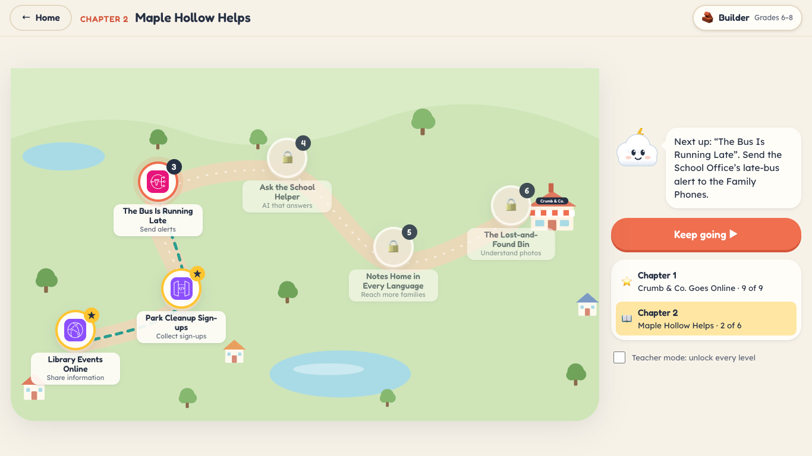
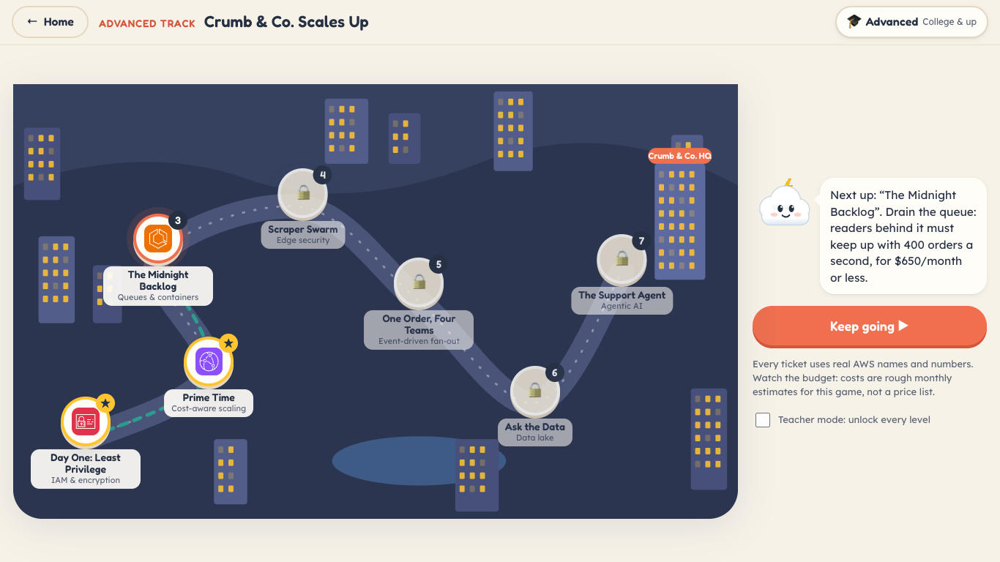
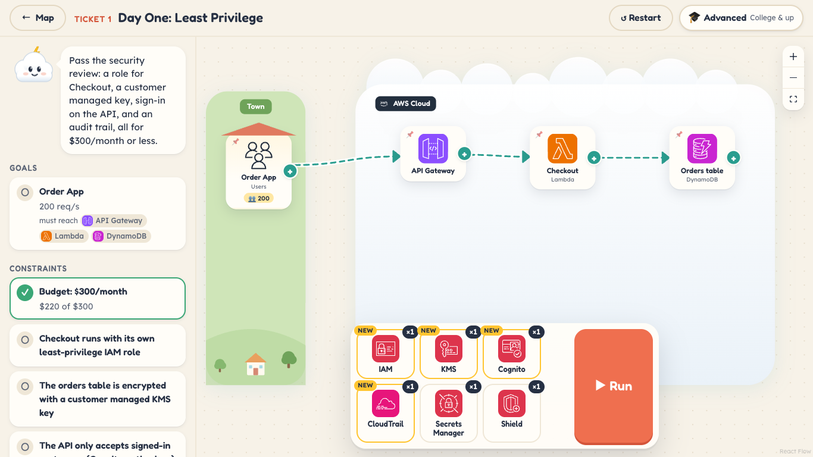
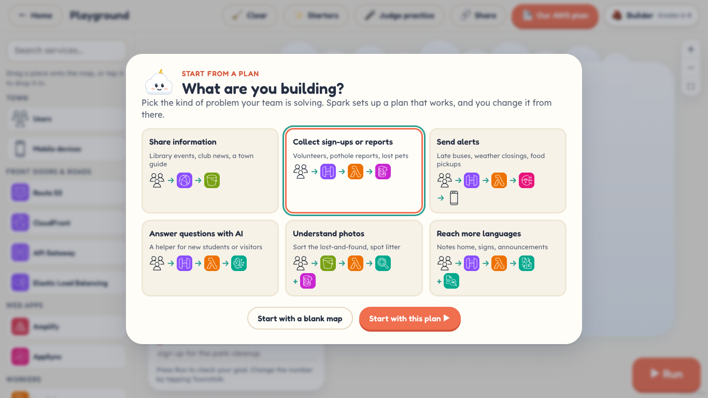
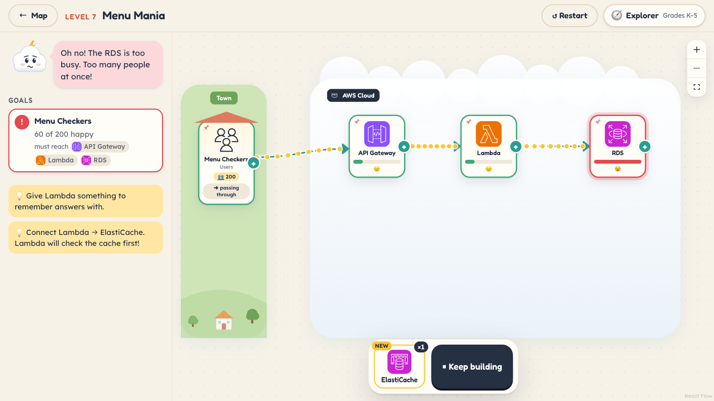

# Spark: Cloud Builders

A visual, game-like web app that teaches students how AWS services fit together. Drag real AWS services onto a
map, connect them, and press **Run** to watch requests flow. Overloaded pieces turn red, queued work waits in
line, and bots get blocked.


## What's inside

### Story Mode (K–12)

Two chapters, 15 levels. Each level gives you a few pieces and a goal. Connect them, press **Run**, and Sparky
explains what happened.

| Chapter 1: Crumb & Co. Goes Online | Chapter 2: Maple Hollow Helps |
|---|---|
|  |  |
| Baker Rosa's bakery goes online in 9 levels: storage, DNS, CDN, serverless, fan-out, scaling, caching, queues, and security. | The whole town needs help in 6 levels: a library events site, park cleanup sign-ups, late-bus alerts, an AI school helper, notes in every language, and a photo lost-and-found. |

| A level running: one server is overloaded | Sparky explains a connection that doesn't fit |
|---|---|
|  |  |

### Advanced Track (college & up)

Seven on-call tickets, two years later. Crumb & Co. is now a national delivery platform and you're its first
cloud engineer. Tickets add constraints beyond "everyone is happy": a monthly **budget**, **required arrows**
(an IAM role, a KMS key, a Cognito authorizer, a CloudWatch alarm), and queues that must **drain**.

| Advanced Track map | A ticket with a budget and security constraints |
|---|---|
|  |  |

Topics: least privilege, cost-aware scaling, queue backlogs and containers, edge security, SNS/SQS fan-out, an
S3 + Athena data lake, and a grounded Bedrock AgentCore agent. Every ticket uses real AWS names and numbers.

### Playground

Build anything with 48 pieces, from S3 and Lambda to IAM, containers, data tools, and Bedrock AgentCore. Only
connections that make sense snap together. Try one that doesn't, and Sparky explains why and suggests what to
connect instead.

| Pick a starter plan | A finished design with a goal, IAM, and KMS |
|---|---|
|  |  |

The Playground also has **challenge tools** for teams pitching an AWS solution to a community problem:

- **Starters**: pick your kind of problem (share information, collect sign-ups, send alerts, AI answers,
  understand photos, more languages) and start from a plan that already works.
- **Your project's words and a goal**: rename any piece ("Sign-up checker") with the AWS name kept underneath,
  and set a goal like "80 volunteers can sign up". **Run** checks it.
- **Why we chose it**: a note on each piece, plus other services that could do the same job and when to pick each.
- **Our AWS plan**: a pitch-ready card with a picture of the map, what each service does, and sources to cite.
  Copy it as text or save it as a picture.
- **Judge practice**: questions a judge might ask, checked against your map: a 10× crowd, who can read your
  data, how you'd know something broke, and why you picked each main service.
- **Share**: a link that carries the whole design. No server or account needed.

### Grade bands

Explorer (K–5), Builder (6–8), Architect (9–12), and Advanced (college & up). Every band uses the real AWS
service names. The band changes the explanations, numbers, and hints. Point at any piece, tray item, or service
chip to see what it does, explained for your band. On a touch screen, tap a piece to open its info card.



## Run it

```bash
npm install
npm run dev        # http://localhost:5173
npm test           # every level is solvable, every preset is a valid connection
npm run build      # static site in dist/
```

The build is a static site with hash routing and a relative base, so `dist/` works from S3 + CloudFront,
Amplify, GitHub Pages, or any sub-path. Progress is saved in the browser. Nothing is sent to a server.

## How it's built

| Path | What lives there |
|---|---|
| `src/data/services.ts` | The 48 pieces: name, per-band blurbs, capacity, and how traffic leaves each one |
| `src/data/rules.ts` | Which connections are allowed (`from → to`), with a "why" for each, and explanations for common mistakes |
| `src/data/levels.ts`, `src/data/chapter2.ts` | Story Mode chapters: story, goals, pre-placed pieces, tray, hints, lesson, and solution |
| `src/data/advanced.ts`, `src/data/costs.ts` | Advanced Track tickets (budgets, required arrows, backlog limits) and rough monthly costs |
| `src/data/starters.ts`, `src/data/alternatives.ts` | Playground starter plans, and which services can do the same job |
| `src/engine/simulate.ts` | Traffic model: a forward pass computes load, a backward pass works out why each request did or didn't finish |
| `src/engine/validate.ts`, `src/engine/objectives.ts` | Connection checks (rule, duplicate, self, loop) and ticket constraints (budget, required arrows, backlog) |
| `src/engine/judge.ts`, `src/engine/share.ts` | Judge-practice questions and share-link encoding |
| `src/components/canvas/` | React Flow canvas, pieces, flowing arrows, the tray, and the "why" bubble |
| `src/components/playground/` | Starters, goal card, project notes, plan export, judge panel, share dialog |
| `src/screens/` | Home, level map, level play, Playground, style guide (`#/styleguide`) |

### Simulation rules

- Townsfolk send *N* visitors. Every piece can handle a set number at once. Anything over that is dropped.
- Front doors (Route 53, API Gateway, load balancer, WAF, SQS) **share** visitors between their arrows.
  Workers (Lambda, EC2, SNS, EventBridge…) **copy** each request to every arrow.
- CloudFront answers about 80% from its copies. ElastiCache answers about 80% of database reads. Auto Scaling
  gives EC2 4× capacity. WAF removes bots. Work coming out of SQS waits instead of being dropped.
- **Badges**: IAM, KMS, Secrets Manager, Shield, Fargate, and Auto Scaling don't carry requests. Their arrows
  pin a badge on the piece they point at. Apart from Auto Scaling's extra capacity, badges never make requests fail.
- Pieces that need somewhere to send work (AgentCore, Firehose, Athena, Glue, AppSync) fail as a dead end without it.

### Add a level

Append to the chapter's level list (`src/data/levels.ts`, `src/data/chapter2.ts`, or `src/data/advanced.ts`),
including a `solution`. Advanced tickets can also set `budget`, `requires`, and `maxBacklog`. `npm test` fails if
the starting setup already passes, if the solution doesn't, or if any arrow isn't an allowed connection.

### Add a service

1. Add its icon mapping to `scripts/import-icons.mjs`, then run
   `npm run icons -- "/path/to/Icon-package_XXXX"` to copy it into `public/icons/`.
2. Add the service to `src/data/services.ts` and its connections to `src/data/rules.ts`.

## Notes

- AWS Architecture Icons © Amazon Web Services, used here to teach architecture. This project is not
  affiliated with or endorsed by AWS.
- Fonts (Fredoka, Lexend) are bundled, so the app works on school networks that block Google Fonts.
- Teacher mode (on the level map) unlocks every level.
