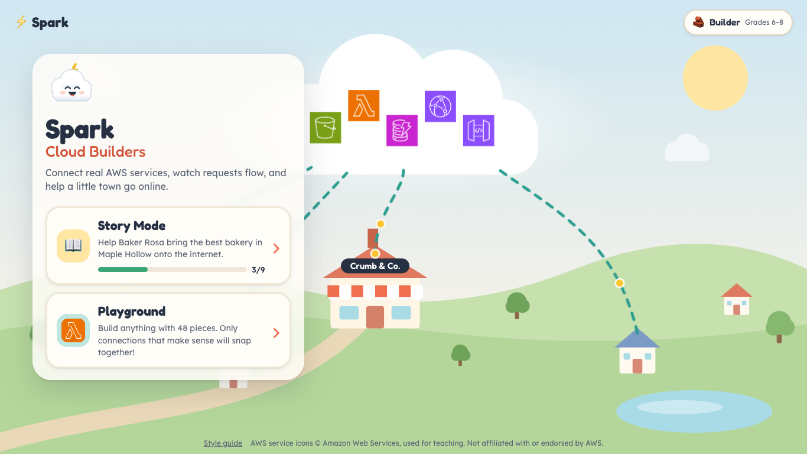
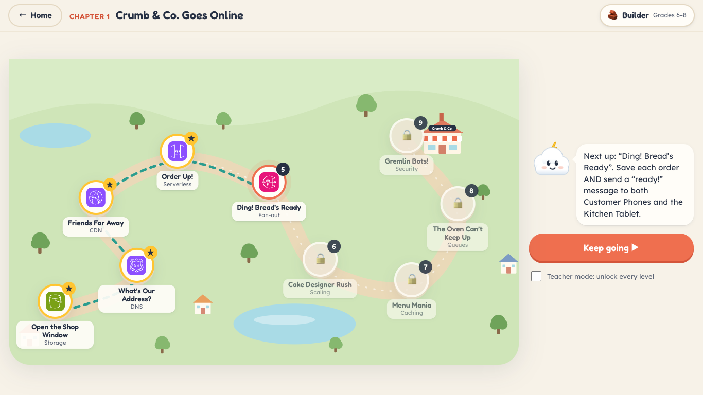
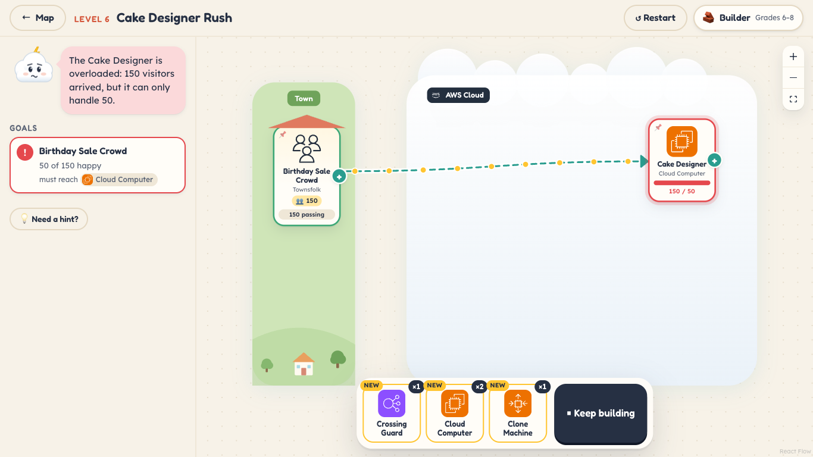
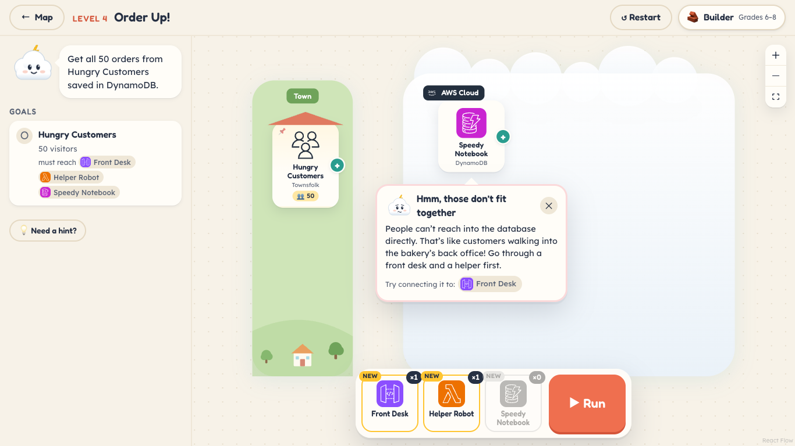
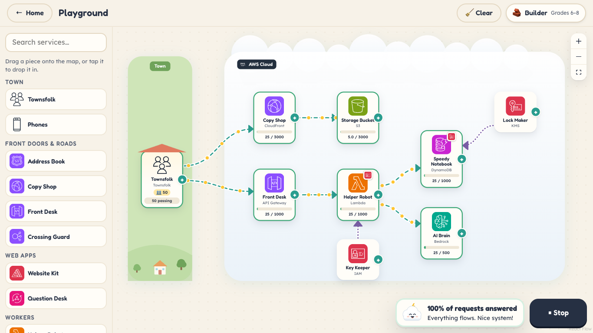

# Spark: Cloud Builders

A visual, game-like web app that teaches K–12 students how AWS services fit together.



- **Story Mode**: 9 levels where Baker Rosa's bakery, Crumb & Co., goes online. Each level gives you a few
  pieces. You connect them and press **Run** to watch requests flow along the arrows. Overloaded pieces
  turn red; queued work waits in line; gremlin bots get blocked.
- **Playground**: build anything with 48 pieces, from S3 and Lambda to IAM, containers, data tools, and Bedrock AgentCore. Only connections that make sense snap together. Try one
  that doesn't, and Sparky explains why and suggests what to connect instead.
- **Grade bands**: Explorer (K–5), Builder (6–8), and Architect (9–12). Each band changes the names,
  explanations, numbers, and hints.

| Story Mode level map | A level running: one server is overloaded |
|---|---|
|  |  |
| **Sparky explains a connection that doesn't fit** | **Playground with IAM and KMS badges** |
|  |  |

## Run it

```bash
npm install
npm run dev        # http://localhost:5173
npm test           # engine + data tests (every level is solvable, every preset is a valid connection)
npm run build      # static site in dist/ — host on S3 + CloudFront, Amplify, GitHub Pages…
```

The app uses hash routing and a relative base, so `dist/` works from any static host or sub-path.
Progress is saved in the browser (localStorage). Nothing is sent to a server.

## How it works

| Path | What lives there |
|---|---|
| `src/data/services.ts` | The 48 pieces: real name, kid nickname, per-band blurbs, capacity, and how traffic leaves each one |
| `src/data/rules.ts` | Directional allow-list of connections (`from → to`), with a verb plus simple and technical "why" text, and hand-written explanations for common mistakes |
| `src/data/levels.ts` | Chapter 1 story, goals, pre-placed pieces, tray palette, hints, lesson, and the intended solution |
| `src/engine/simulate.ts` | Traffic model. A forward pass computes the load on every piece; a backward pass works out why each request did or didn't finish |
| `src/engine/validate.ts` | Connection checks: rule, duplicate, self, and loop |
| `src/components/canvas/` | React Flow canvas, pieces, flowing dashed edges with request dots, the tray (drag or tap), and the "why" bubble |
| `src/screens/` | Home, Level map, Level play, Playground, Style guide (`#/styleguide`) |

### Simulation rules (kid version)
- Townsfolk send *N* visitors. Every piece can handle a set number at once. Anything over that is dropped.
- Front doors (Route 53, API Gateway, load balancer, WAF, SQS) **share** visitors between their arrows.
  Workers (Lambda, EC2, SNS, EventBridge…) **copy** each request to every arrow.
- CloudFront answers ~80% from its copies. ElastiCache answers ~80% of database reads. Auto Scaling
  gives EC2 4× capacity. WAF removes bots. Work coming out of SQS waits instead of being dropped.
- **Badges**: IAM, KMS, Secrets Manager, Shield, Fargate, and Auto Scaling don't carry requests. Their arrows pin
  a badge on the piece they point at (for example, IAM → Lambda gives Lambda a permission badge). Apart from Auto
  Scaling's extra capacity, badges never make requests fail.
- Pieces that need somewhere to send work (AgentCore, Firehose, Athena, Glue, AppSync) fail as a dead end without it.

### Add a level
Append to `LEVELS` in `src/data/levels.ts`, including a `solution`. `npm test` fails if the starting
setup already passes, if the solution doesn't, or if any arrow isn't an allowed connection.

### Add a service
1. Add its icon mapping to `scripts/import-icons.mjs`, then run
   `npm run icons -- "/path/to/Icon-package_XXXX"` to copy it into `public/icons/`.
2. Add the service to `src/data/services.ts` and its connections to `src/data/rules.ts`.

## Notes
- AWS Architecture Icons © Amazon Web Services, used here to teach architecture.
  This project is not affiliated with or endorsed by AWS.
- Fonts (Fredoka, Lexend) are bundled via Fontsource, so the app works on school networks that block Google Fonts.
- Teacher mode (on the level map) unlocks every level.
